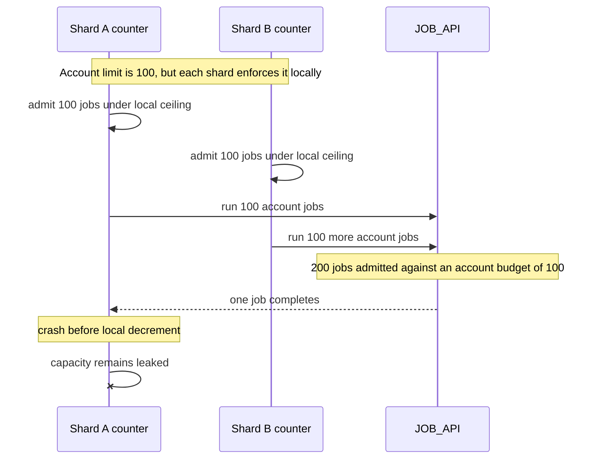
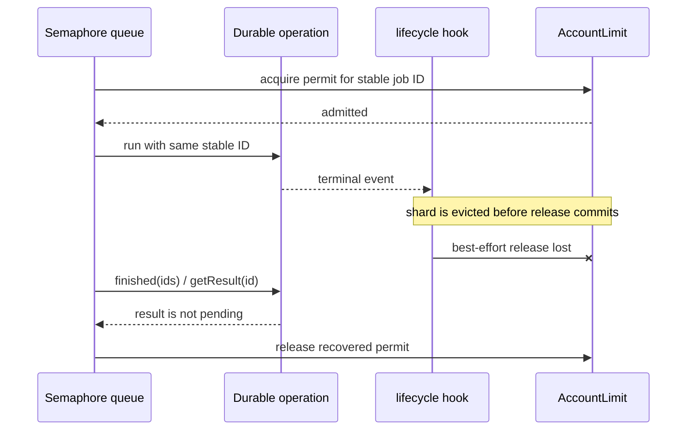

This example admits jobs against an account-scoped semaphore before running them as durable operations. It separates the globally shared budget from the objects that queue and execute work:

- `AccountLimit` owns an account key's semaphore state and optional workflow group limits.
- `JobShard` owns admission queue state, operation records, and calls to `JOB_API`.
- A request groups jobs by a deterministic shard name before submitting them.

The resulting limit is global for an account even when many job shards use the same account key. It is a bound on **admitted durable operations**, not a blanket proof about every external process that might ignore cancellation.

## Source and prerequisites

- [Worker source](https://github.com/avenceslau/durability/blob/main/examples/account-concurrency/worker.ts), [Wrangler configuration](https://github.com/avenceslau/durability/blob/main/examples/account-concurrency/wrangler.jsonc), and [Vite transform configuration](https://github.com/avenceslau/durability/blob/main/examples/account-concurrency/vite.config.ts)
- Provision `JOB_API`, set `ACCOUNT_CONCURRENCY`, and deploy the `AccountLimit` and `JobShard` Durable Object classes. The Vite transform maps the semaphore client target to the exported class/Wrangler metadata.
- Make `JOB_API` honor `Idempotency-Key`; retries can create repeated physical HTTP requests.

The pieces are [semaphore](/primitives/semaphore/), [semaphore queue](/primitives/semaphore-queue/), [operations](/primitives/operations/), a per-object [scheduler](/primitives/scheduler/), and the queue's internal [outbox](/primitives/outbox/).

## Architecture

<ArchitectureWalkthrough example="concurrency">

<Render file="architecture-help" />

</ArchitectureWalkthrough>

`AccountLimit` and `JobShard` each create their own `DurabilityScheduler` and delegate `alarm()` to it. In a shard, that scheduler drives the queue, its internal outbox, and `jobs` operations together. It does not coordinate state across objects: the semaphore holder is the cross-shard authority because every queue asks it for permits keyed by `accountId`.

| State or responsibility        | Owner                    | Stable identity                  |
| ------------------------------ | ------------------------ | -------------------------------- |
| Account capacity and leases    | `AccountLimit` semaphore | queue `key`: `accountId`         |
| Workflow cap                   | `AccountLimit` map       | queue `group`: `workflowId`      |
| Pending admission and recovery | `JobShard` queue/outbox  | item `id`: `job.id`              |
| Executing/retrying work        | `JobShard` operation     | operation `id`: `job.id`         |
| External side effect           | `JOB_API`                | HTTP `Idempotency-Key`: `job.id` |

The repeated job ID is intentional across queue, operation, and API. It gives each retry a way to recognize the same logical job without making the three stores one transaction.

## End-to-end flow

1. The worker accepts only `POST` and parses a demo array of `Job` values. It groups them by `shardFor(job.accountId)` and sends every group to one `JobShard`.
2. `JobShard.submit` enqueues each item with a stable job ID, `key: accountId`, `group: workflowId`, and the full job body. Repeating an admission with the same ID is intentionally a no-op.
3. The queue uses the generated `limits` semaphore client to obtain permission from the account's `AccountLimit`. All shards using the same account key contend on that one semaphore.
4. `AccountLimit` has a dynamic account ceiling from `ACCOUNT_CONCURRENCY`; it may also impose a workflow group ceiling from `workflowLimits`.
5. Strict lease provisioning grants up to 16 permits per lease with a ten-minute reporting lifetime. `strict` accounts for both grants and lease footprint under the configured account limit, rather than allowing local shards to over-reserve capacity. Renewal and retirement preserve accounting for work that may still be running; expiry does not simply erase its footprint.
6. When the queue admits an item, its `admit` callback calls `jobs.run({ id: item.id, payload: item.body })`. The operation uses the same ID as the queue item, so an admission retry does not start a distinct operation.
7. `run` posts to `JOB_API` with `Idempotency-Key: id`, passes the operation abort signal, and retries at most three operation attempts.
8. On a completed attempt or terminal event, the lifecycle hook releases the permit immediately. The queue's `finished(ids)` path also asks `jobs.run.getResult(id)` and returns IDs no longer pending, reclaiming permits when that best-effort lifecycle release was missed.

## The connecting code

The stable identity must cross the queue-to-operation boundary:

```ts
admit: (items) => Promise.all(
  items.map((item) => this.jobs.run({ id: item.id, payload: item.body }))
).then(() => undefined),

submit(jobs: Job[]) {
  return this.permits.enqueue(jobs.map((job) => ({
    id: job.id, key: job.accountId, group: job.workflowId, body: job,
  })));
}
```

The lifecycle hook is a low-latency release path, not the sole source of recovery:

```ts
onLifecycleEvent: (event) => {
  const finished = event.type === 'terminal' ||
    (event.type === 'attempt_settled' && event.outcome === 'completed');
  return finished && 'id' in event
    ? this.permits.release(event.id).then(() => undefined)
    : undefined;
},
finished: async (ids) => {
  const results = await Promise.all(ids.map((id) => this.jobs.run.getResult(id)));
  return ids.filter((_, i) => results[i]?.status !== 'pending');
},
```

## A naive design and its break

Do not keep independent running counters in each job shard. A counter can be incremented independently by several shards and exceed an account's global ceiling; a crash after work settles but before decrement leaks capacity forever.



The semaphore is the shared capacity mechanism. Strict leases prevent a shard's prefetched lease from silently making grants plus reservations exceed the limit. The queue persists admission and can re-check operation completion, so it has a recovery path for a lost release notification.

## Lost release recovery



The recovery only works because admission is retried with stable IDs and the operation result remains inspectable. `getResult(id)` has a retention boundary: once operation history is purged it can be `not_found`/unavailable. Treat that case deliberately in production—do not purge result history before all queue recovery paths have resolved, or retain a separate durable completion record.

## Sharding note

The design permits many `JobShard` objects to submit to a shared account key. This **demo does not spread one account across four shards**: `shardFor(accountId, width = 4)` hashes the account but returns `${accountId}-${hash % width}`. For a given account it always returns one stable name; the width merely selects that account's suffix. A production router may distribute an account across multiple stable shards, but every such shard must still submit with the same `key: accountId` to preserve the shared budget.

## Failure and semantics table

| Situation                           | What this composition does                                                                  | Remaining concern                                                                                                                                   |
| ----------------------------------- | ------------------------------------------------------------------------------------------- | --------------------------------------------------------------------------------------------------------------------------------------------------- |
| Repeated submit/admit               | Queue item ID equals operation ID, making retries idempotent at both boundaries.            | Clients must choose stable, unique job IDs.                                                                                                         |
| Several shards submit one account   | All ask one account-keyed semaphore.                                                        | Do not replace it with per-shard counters.                                                                                                          |
| Fast lifecycle release is lost      | Queue's `finished()` checks the operation and returns non-pending IDs for release.          | Keep operation results long enough; handle `not_found` after purge.                                                                                 |
| Job API fails                       | Operation has at most three attempts and terminal failure releases capacity.                | API must honor the idempotency key.                                                                                                                 |
| Workflow limit changes              | `limitWorkflow` changes an in-memory `Map`; it affects later rounds.                        | The group-limit configuration is ephemeral and is lost on object eviction; persist/configure it externally if it matters.                           |
| Lease holder is idle or disappears  | Strict leases have a 10-minute reporting lifetime and reserve at most 16 permits per lease. | Expired/retired footprint is not blindly forgotten while work may still run; reconcile usage and tune lease size/TTL.                               |
| Abort is signalled to external work | `signal` is passed to `fetch`.                                                              | An abort-ignoring API may continue running after the operation is no longer active, so the semaphore does not prove universal external concurrency. |

## Production work left to the application

Authenticate and validate untrusted request bodies; the example explicitly calls its input demo-only. Persist administrative workflow limits instead of relying on the `Map`, define queue/result retention, and observe permit usage and stuck work. Treat the account semaphore as admission control, while `JOB_API` idempotency and cancellation behavior govern what actually happens outside Workers. If you change routing to spread a single account over shards, test failures and retries with the same account key and stable job IDs.
