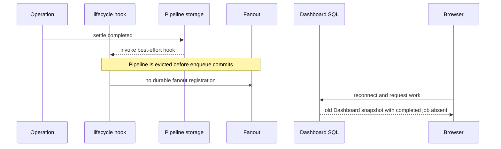
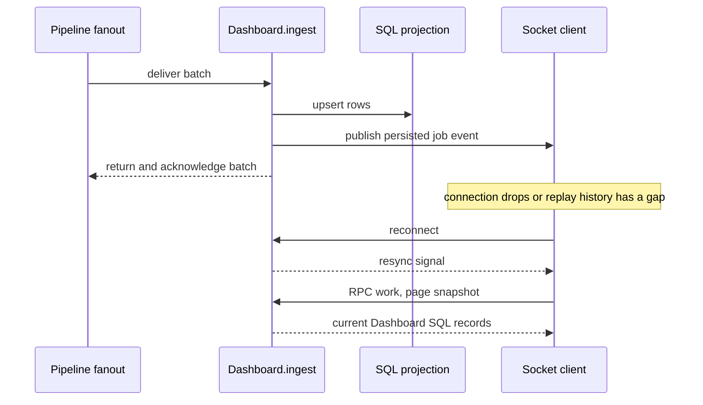

A tenant can import orders and watch their state in a browser. The example deliberately separates the object that owns job execution from the object that owns the dashboard read model:

- `Pipeline` owns `importOrder` operations and their results.
- `Dashboard` owns an SQL projection and WebSocket sessions.
- The browser reads and resynchronizes only that projection; it never treats it as the authoritative pipeline.

This is a useful shape when clients need a responsive view, but the business result must remain with the worker that executed it.

## Source and prerequisites

- [Worker entry](https://github.com/avenceslau/durability/blob/main/examples/job-dashboard/worker.ts), [Pipeline](https://github.com/avenceslau/durability/blob/main/examples/job-dashboard/pipeline.ts), [Dashboard](https://github.com/avenceslau/durability/blob/main/examples/job-dashboard/dashboard.ts), and [browser client](https://github.com/avenceslau/durability/blob/main/examples/job-dashboard/client.ts)
- [Shared types](https://github.com/avenceslau/durability/blob/main/examples/job-dashboard/shared.ts) and [Wrangler configuration](https://github.com/avenceslau/durability/blob/main/examples/job-dashboard/wrangler.jsonc)
- Provision the `ORDERS` service binding and deploy both `Pipeline` and `Dashboard` Durable Object classes. The example's browser host is intentionally a placeholder and must be replaced.

The composition uses [operations](/primitives/operations/), a shared [scheduler](/primitives/scheduler/), [fanout](/primitives/fanout/), [tracker](/primitives/tracker/), [socket](/primitives/socket/), and the browser [client](/primitives/client/).

## Architecture

<ArchitectureWalkthrough example="dashboard">

<Render file="architecture-help" />

</ArchitectureWalkthrough>

There is one named `Pipeline` and one named `Dashboard` per tenant. They are separate failure and persistence boundaries. The pipeline's scheduler drives both its `Durability` operations and `DurabilityFanout`; its `alarm()` delegates to that one scheduler. The dashboard has no scheduler because SQL, its custom tracker source, and `DurabilitySocket` do not need background alarm work in this example.

| State or responsibility      | Owner                          | Identity or recovery boundary                     |
| ---------------------------- | ------------------------------ | ------------------------------------------------- |
| Order execution and result   | `Pipeline`                     | `import:<orderId>` operation record               |
| Tracker source for execution | `Pipeline` `DurabilityTracker` | operation state retained by Durability            |
| Dashboard delivery           | Pipeline fanout                | `id:generation:status` message until acknowledged |
| Browser read model           | `Dashboard` SQL                | tenant dashboard object and SQL upsert            |
| Connected-browser cache      | Browser                        | reloads from Dashboard `work` snapshot            |

No row in this table turns the cross-object handoff into a transaction. The identity makes retries safe at each boundary; reconciliation is still needed where an event is never handed off.

## End-to-end flow

1. The front worker routes `POST /tenants/:tenant/imports?order=:id` to that tenant's `Pipeline`; `/ws` upgrades against its `Dashboard`.
2. `Pipeline.importOrder(orderId)` registers an operation with the stable ID `import:<orderId>`. Registration means accepted, not completed. Repeating the same import targets the same operation record.
3. The operation fetches `ORDERS` using the durable operation ID as `Idempotency-Key`. The external service must honor that key because retries can repeat a request.
4. The pipeline's `DurabilityTracker` exposes its operations as source `jobs`. `track(orderId)` gets the handle for `import:<orderId>`; the front worker and dashboard can call `wait()` in one pipelined Workers RPC path.
5. `includeResults: true` puts a completed operation's order summary on its lifecycle event. Lifecycle callbacks publish that `pending`, `completed`, or `failed` `JobEvent`; each fanout message has a stable identity: `id:generation:status`.
6. Fanout shares the pipeline scheduler and batches for up to 100 ms. It invokes `Dashboard.ingest(messages)` and acknowledges only when that method returns (`ackOnReturn: true`), so a failed call or eviction is redelivered.
7. `Dashboard.ingest` upserts its own `jobs` SQL table, emits a socket `job` event, and wakes local tracker watchers. Its `TrackedSource` is the SQL table plus the in-memory watcher map; it is not the pipeline's source.
8. On connection or a replay gap, the browser calls socket RPC `work`, pages through `tracker.records()`, and replaces its local map with the Dashboard snapshot. Incremental `job` events then update that map.

## The connecting code

The stable operation identity makes registration retries safe:

```ts
importOrder(orderId: string) {
  return this.durability.importOrder({
    id: `import:${orderId}`,
    payload: { orderId },
  });
}
```

Lifecycle events become independently retried fanout messages. Include the generation in the delivery ID: reusing an operation ID for a new generation must not collide with its earlier projection event.

```ts
await this.fanout.enqueue([
  {
    id: `${event.id}:${event.generation}:${state.status}`,
    body: {
      id: event.id,
      name: 'importOrder',
      generation: event.generation,
      createdAt: event.timestamp,
      state,
    },
  },
]);
```

The dashboard only lets a same-generation event replace a `pending` row. A **different** generation can replace it, regardless of age; the SQL does not order generations. A late same-generation `pending` cannot overwrite a settled row, but a delayed older generation is not fenced by this predicate.

```sql
ON CONFLICT(id) DO UPDATE SET status = excluded.status, state = excluded.state
WHERE excluded.generation != jobs.generation OR jobs.status = 'pending'
```

## A naive design and its break

A tempting version sends a WebSocket message directly from the operation's lifecycle callback and treats the client as the state store. It loses updates whenever a browser, object, or network call disappears. Fanout fixes delivery _after enqueue_, and the socket fixes a retained-event replay gap, but there is an earlier gap in this example.



The hook is best effort even though `fanout.enqueue` is durable once it commits. An eviction between settling the operation and committing that enqueue can lose the completed projection permanently. Socket replay/resync cannot repair it: `work` reads **Dashboard SQL**, not authoritative `Pipeline` operations. Reconnecting to a stale dashboard only reproduces stale state.

For correctness-sensitive production dashboards, reconcile from an authoritative pipeline/history source: periodically enumerate or query authoritative jobs, compare generations and states with the projection, and idempotently write missing rows. Alternatively, stage the projection handoff from inside the operation handler with an application-owned durable record keyed by operation ID, then drain/reconcile it. Either approach needs defined retention and conflict rules.

## Recovery boundaries



If `ingest` throws before returning, fanout retains and retries the batch. If it returns, that batch is acknowledged. A client that missed socket history receives a resync signal and rebuilds from SQL. These mechanisms recover transport and replay gaps, not the missing lifecycle-to-fanout enqueue shown above.

## Failure and semantics table

| Situation                                 | What this composition does                                                                                                                                            | Remaining concern                                                                                                                       |
| ----------------------------------------- | --------------------------------------------------------------------------------------------------------------------------------------------------------------------- | --------------------------------------------------------------------------------------------------------------------------------------- |
| Duplicate import request                  | Stable `import:<orderId>` ID deduplicates at the Pipeline operation boundary.                                                                                         | Reusing an ID has generation semantics; choose that API deliberately.                                                                   |
| `ORDERS` call retries                     | Sends the operation ID as `Idempotency-Key`.                                                                                                                          | `ORDERS` must implement idempotency.                                                                                                    |
| Dashboard call fails or object is evicted | Fanout retries until `ingest` returns.                                                                                                                                | The original lifecycle enqueue must already have committed.                                                                             |
| Late `pending` delivery                   | SQL refuses to replace a settled row of the same generation.                                                                                                          | This is not a total ordering protocol.                                                                                                  |
| Failed attempt followed by retry          | A failed `attempt_settled` event can project `failed` while the operation is still pending retry. The SQL can then reject a later same-generation `completed` update. | This is a concrete recipe limitation: project terminal failure only after checking authoritative state, and add ordered reconciliation. |
| Old generation arrives late               | Any different generation passes the SQL update predicate.                                                                                                             | Add an authoritative generation/version order; inequality alone is not a freshness check.                                               |
| Browser misses events                     | Socket replay, then `resync` and `work` snapshot recover the Dashboard view.                                                                                          | Snapshot cannot discover a pipeline event never projected.                                                                              |
| RPC waiter disconnects or times out       | The operation continues; a later caller can query/wait again.                                                                                                         | `wait()` is an ephemeral request, not a durable subscription.                                                                           |

## Production work left to the application

Authenticate tenant selection, authorize imports and dashboard reads, validate order IDs, and replace `wss://jobs.example.com` in the client with the deployed host. Add rate limits and limits to `work` queries. Define projection reconciliation, retention, and explicit same-generation terminal conflict semantics before treating the dashboard as a business record. For durable user notifications, store subscription intent separately; an RPC wait is only a live connection's convenience.
