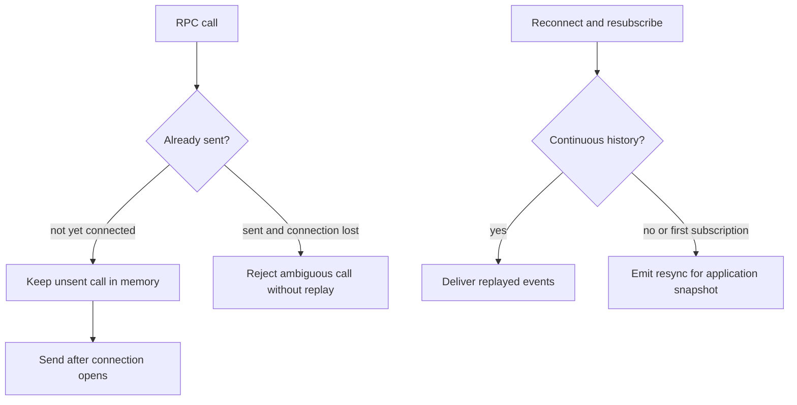

Import `DurabilitySocketClient` from `durability/client`. This browser-safe entry point has no Workers runtime import. Connect it to a [DurabilitySocket](/primitives/socket/) server.

## Behind the scenes

**Durable state: none.** A connection keeps its handlers, pending RPCs, subscriptions, and last observed sequence in browser memory. It opens lazily on the first call/subscription, reconnects with jittered backoff, and resubscribes from that in-memory sequence. A page reload loses it.



**On disconnect:** sent unanswered calls reject with `SocketConnectionLostError` rather than being replayed; the server may already have performed them. Unsent calls can wait for connection until their local timeout. The default RPC timeout is two minutes, not remote cancellation.

**Recovery belongs to the application:** `on.resync` must rebuild affected state from an authoritative snapshot. A snapshot of an already-stale projection cannot repair an event lost before it reached that projection. Explicit `close()` ends reconnection, removes handlers, and rejects remaining calls.

See [live job dashboards](/compositions/job-dashboard/) for push, replay, snapshots, and the difference between transport recovery and projection reconciliation.

Implementation: [`client.ts`](https://github.com/avenceslau/durability/blob/main/packages/durability/src/client.ts) (`Connection`, `DurabilitySocketClient`).

## Browser client

The browser client derives every method and event type from the socket:

```ts
import { DurabilitySocketClient, logging } from 'durability/client';
import type { TodoList } from '../worker'; // type-only: nothing from the Worker is bundled

const client = new DurabilitySocketClient<TodoList['socket']>({
  url: (listId) => `wss://example.com/lists/${listId}/ws`,
}).with(logging());

const conn = client.connect('personal');
const todos = await conn.rpc.list();
await conn.rpc.createTodo({
  id: crypto.randomUUID(),
  payload: { id: 'todo-1', title: 'Ship it', done: false },
});
await conn.rpc.toggle('todo-1');

conn.on.updated((todo) => render(todo));
conn.on.lifecycle((e) => {
  if (e.entityKind === 'operation' && e.type === 'attempt_settled') {
    markSettled(e.id);
  }
});
conn.on.resync(({ names }) => reload(names)); // first subscription, and after an unreplayable gap
conn.on.status((status) => showStatus(status)); // connecting | connected | disconnected | closed
conn.close();
```

`on.resync` reports the outbound events whose subscribers have no continuous history: every mapped name on their first subscription, newly added names on a live connection, and all names after an unreplayable gap. Rebuild the affected state from an inbound snapshot call; `@durability/tanstack-db` does this for collections.

Connections open lazily on the first call or subscription and reconnect with jittered exponential backoff. Calls queued before the socket opens are sent once; calls already sent when the connection drops reject with `SocketConnectionLostError` and are never replayed, because the server may have run them. Route retried mutations through `Durability` with a stable idempotency key rather than re-calling. Calls reject with `SocketTimeoutError` after `timeoutMs` (default 2 minutes). Server-side handler failures reject with `SocketRemoteError`, carrying the server error's `name` and `message`. `with(transform)` returns a new client that wraps every call; transforms receive `{ method, input, next }` and may replace the input.

`durability/client` imports nothing from `cloudflare:workers` and is typechecked against DOM types only. The complete, typechecked version of this example lives in [`examples/realtime-todos`](https://github.com/avenceslau/durability/blob/main/examples/realtime-todos).
