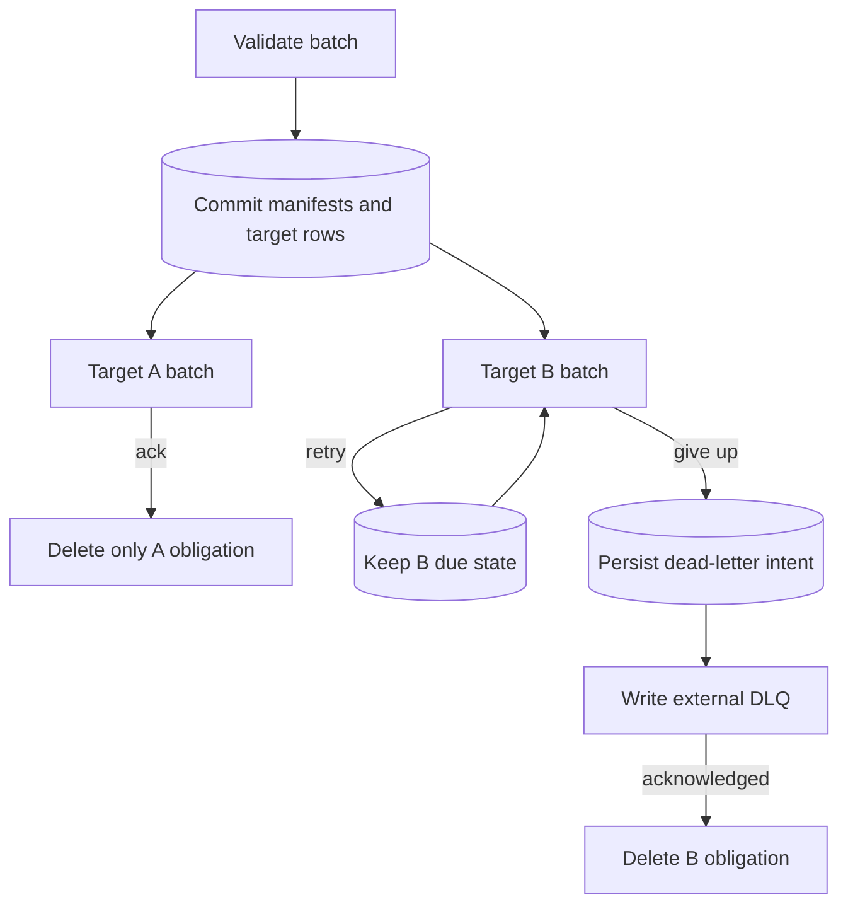

Import `DurabilityFanout` from `durability`. Use it when every accepted message has independently retryable delivery obligations. See the [email delivery composition](/compositions/email-delivery/).

## Behind the scenes

**Durable state:** `durability_fanout_messages` stores a manifest per active deduplication key. `durability_fanout_deliveries` stores one obligation per message-target pair, with sequence, phase, attempt, and due time. A sequence table orders first deliveries; retry memos are shared with other capabilities.

`enqueue()` validates the whole batch, then transactionally inserts manifests and the frozen target set and reconciles the alarm. Due delivery runs in bounded batches per target under the scheduler's shared permits. Consumer RPC happens outside the acceptance transaction.



**Settlement:** `ack()` removes one obligation and its memos. When no obligations remain, the manifest is removed too. A normal consumer return without settlement is not acknowledgement unless `ackOnReturn` is enabled. `retry()` persists another eligibility time. Dead-letter intent is committed before external DLQ writing, so a storage outage retries the DLQ path rather than resending to the consumer.

**After a crash:** an outstanding target can receive the same delivery again. The consumer or storage sink must deduplicate the appropriate stable message/delivery identity. An already acknowledged sibling stays settled. Removed target IDs remain pending rather than being silently rerouted.

**Lifetime:** deduplication ends when the last obligation settles; this is not permanent operation history. There is no automatic archive/DLQ retention policy and no public fanout purge API.

Implementation: [`fanout.ts`](https://github.com/avenceslau/durability/blob/main/packages/durability/src/fanout.ts) (`enqueue`, target delivery, settlement, and manifest removal); [`migrations.ts`](https://github.com/avenceslau/durability/blob/main/packages/durability/src/migrations.ts).

## Routing and fanout

A queue is a composition, not another exported abstraction. An application owns its DO class and attaches the capabilities it needs:

```ts
import { DurableObject } from 'cloudflare:workers';
import {
  DurabilityFanout,
  DurabilityScheduler,
  type FanoutInput,
  type StoredMessage,
} from 'durability';
import { DurabilityRouting } from 'durability/routing';

export class Mailbox extends DurableObject<Env> {
  private readonly scheduler = new DurabilityScheduler({ context: this.ctx });
  private readonly routing = new DurabilityRouting();
  private readonly fanout = new DurabilityFanout<Job>({
    scheduler: this.scheduler,
    routing: this.routing,
    targets: {
      consumer: { deliver: (messages) => this.env.CONSUMER.consume(messages) },
      archive: { storage: (message) => this.store('archive/', message) },
    },
    dlq: (message) => this.store('dead-letters/', message),
  });

  private async store(prefix: string, message: StoredMessage<Job>) {
    await this.env.ARCHIVE.put(
      `${prefix}${encodeURIComponent(message.id)}`,
      JSON.stringify(message),
      { onlyIf: { etagDoesNotMatch: '*' } }
    );
  }

  enqueue(messages: FanoutInput<Job>[]) {
    return this.fanout.enqueue(messages);
  }

  alarm(info?: AlarmInvocationInfo) {
    return this.scheduler.alarm(info);
  }
}

const routing = DurabilityRouting.client({
  target: Mailbox,
  invoke: (stub, messages: FanoutInput<Job>[]) => stub.enqueue(messages),
  sharding: (messages, context: { tenant?: string } | undefined) => ({
    shard: context?.tenant ?? messages[0]?.body.customerId ?? 'default',
    locationHint: 'weur',
  }),
});

const result = await routing.push([{ id: 'job:42', body: job }], {
  tenant: 'acme',
});
```

The application chooses the RPC method via `invoke`; routing does not know about messages or fanout. A single push selects one shard for the entire input. Static fanout target IDs identify independent delivery obligations; each accepted message snapshots its recipients. Targets added later do not receive old work, and a removed target's work remains durable with an error and backoff until that ID is restored. Target callbacks/storage references are fixed at capability construction.

### Acceptance, not completion

`fanout.enqueue` accepts a message or batch and returns:

```ts
type EnqueueResult<T> =
  | { success: true; value: T; load: LoadSnapshot }
  | {
      success: false;
      error: { name: string; message: string };
      load: LoadSnapshot;
    };
```

Fanout's value is the message ID array; an application RPC can return its own value with the same envelope. Success means the entire batch and its target obligations were committed, not that consumers ran. Definite validation/conflict rejection returns `success: false` with no partial batch. Storage/commit uncertainty throws, as does an RPC transport failure: the caller must not infer non-acceptance. Routing never silently retries or switches shards on a failed call. The caller decides whether to retry on the same or a different shard.

`id` defaults to a UUID. `deduplicationKey` defaults to `id`; while a registration remains active, repeating that key with identical ID, payload, and recipient set does not redeliver acknowledged siblings. Reusing it for different work rejects the batch. After the final target settles, the message manifest is removed and the key may be reused. This is not permanent or cross-shard deduplication. Consumers must make side effects idempotent for at-least-once delivery.

### Independent delivery

First deliveries are ordered by enqueue sequence per shard and target. Waiting retries do not block later first deliveries; completion order is not guaranteed. Each scheduler pass advances a bounded batch per target (`maxBatchSize`, default 10) with the shared concurrency pool. Different targets progress independently subject to that capacity.

Set `batchDelayMs` to hold first deliveries for up to that many milliseconds, so messages enqueued together reach the consumer as one batch instead of one call each. Each first attempt is rounded up to the next multiple of `batchDelayMs`, so messages enqueued within the same window become due at the same time. It delays delivery, not acceptance: `enqueue` still returns once the batch commits. Retries keep their policy delay.

Consumer callbacks may forward the batch to any ordinary WorkerEntrypoint RPC method. Messages include `id`, `deliveryId`, `target`, `body`, `attempt`, `enqueuedAt`, a [`memoize`](/reference/memoization/#memoize) scoped to that message and target, so a retried delivery reuses work an earlier attempt finished, and callable settlement capabilities:

- `ack()` settles this target only.
- `retry(10)` schedules eligibility after 10 ms, overriding the policy delay. It is not a real-time delivery guarantee.
- `deadLetter()` records durable terminal intent before writing to the DLQ. Exhaustion does the same automatically.
- Returning, throwing, or timing out leaves unsettled messages eligible for retry. A second or late settlement call rejects with `FanoutSettlementError`.

Each settlement call is an RPC back into the Durable Object plus a storage transaction. For consumers that only ever acknowledge the whole batch, set `ackOnReturn: true` on the target: when `deliver` returns without throwing, every message the consumer did not settle explicitly is acknowledged in one transaction, without a call per message. Explicit `retry()` and `deadLetter()` calls still apply, and a throw or timeout acknowledges nothing.

```ts
targets: {
  consumer: {
    deliver: (messages) => this.env.CONSUMER.consume(messages),
    ackOnReturn: true,
  },
},
batchDelayMs: 100,
```

Await settlement calls. Timed-out RPCs cannot be forcibly cancelled, so side effects may overlap later attempts. Storage targets automatically acknowledge successful writes; failed writes retry independently of consumer targets. Their write contract must be idempotent by the supplied delivery identity.

### DLQ storage and per-target redrive

Fanout only ever **writes** to storage, so a storage target and the `dlq` are both just a write function:

```ts
type MessageWrite<Body> = (message: StoredMessage<Body>) => Promise<void>;
```

No adapter class or storage interface ships with the library: R2, DO storage, D1, or an HTTP endpoint are all one callback. What separates an archive from a dead letter is the **role in the flow**, not the type — a storage target receives every message on the success path, while `dlq` receives only what a target gave up on. Both may write to the same bucket under different prefixes.

A stored entry carries `id` (unique per registration and target), `messageId`, `target`, `body`, `enqueuedAt`, `storedAt`, and `attempts`; only dead letters also carry `failure: { reason, error }`.

Two write invariants are the application's to uphold:

- **Key each entry by `id` and refuse to overwrite it.** `id` is stable across delivery attempts, so a retried write collapses onto the same entry (`onlyIf: { etagDoesNotMatch: '*' }` on R2) and a redrive deletes exactly what it re-enqueued. `attempts` and `storedAt` advance between attempts, so entries are not byte-identical.
- **Delete only after acceptance.** Reading entries back for replay or redrive is application policy, so nothing in the library lists or removes them.

Retention is likewise external: filter on `storedAt` when selecting entries to redrive, and configure a **lifecycle deletion rule** on the prefix (for example 30 days on a DLQ prefix, unbounded for an archive) for physical expiry. A failed dead-letter write retains the terminal intent with a 60-second backoff rather than redelivering to the consumer. Omitting `dlq` drops terminal deliveries: nothing could ever accept them, and retrying would keep the object awake indefinitely. The `terminal` lifecycle event still reports each one.

Redrive is explicit application code, not queue sugar. Walk your own storage, select what to replay, then enqueue only the failed target:

```ts
const result = await routing.push({
  messages: [
    { id: entry.messageId, body: entry.body, deduplicationKey: entry.id },
  ],
  options: { targets: [entry.target] },
});
if (result.success) {
  await dlq.remove(entry.id);
}
```

Here the application RPC forwards `messages` and `options` to `fanout.enqueue`. A fresh registration resets attempts; using the DLQ entry ID as the key avoids colliding with the original message's still-running siblings. Never remove an entry on rejection or transport uncertainty. A crash between re-enqueue and removal may still duplicate delivery.
