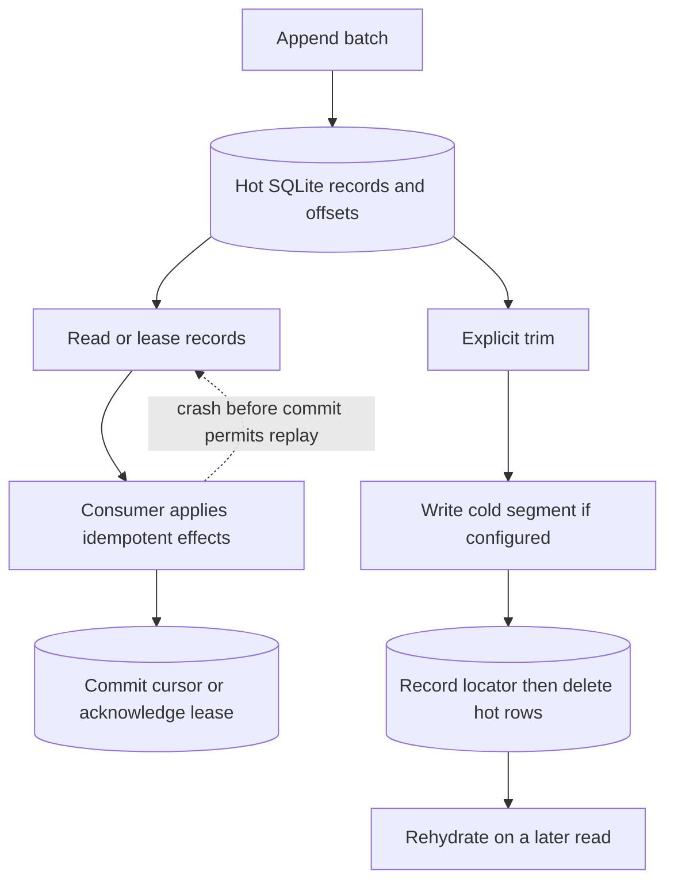

Import `DurabilityLog` from `durability`. Use retained records when consumers need independent positions and replay. See the [event-stream composition](/compositions/event-stream/).

## Behind the scenes

**Durable state:** `durability_log_records` holds hot records by offset, with a unique retained deduplication key. Cursor, sequence/byte-count, and cold-segment metadata tables track readers and storage. Optional leasing adds durable lease/allocation tables.

`append()` allocates offsets and inserts the batch atomically. Reading does not acknowledge anything: `commit()` only advances one consumer cursor. Optional `lease()` persists an exclusive range before returning records; fresh batch IDs fence expired or superseded holders, and acknowledgements advance only across contiguous settled ranges.



**Not an automatic background loop:** the log can share a scheduler's storage engine but does not register a due-work participant. Nothing periodically calls `trim()` for you. Compose a named alarm when retention needs a clock.

**Cold-storage failure:** the external segment is written before its locator is committed and hot records are removed. A failed write preserves hot data. A crash after the remote write may repeat it or leave an orphan; use idempotent segment keys. The cold store's lifecycle and removal of obsolete locators are application policy.

**Lifetime:** retention ignores consumer cursors. A slow reader can lose readable history and gets `LogTruncatedError`. Append deduplication ends when the original hot record is flushed or deleted. Processing can repeat after an effect succeeds but before cursor/lease settlement, so effects still need idempotency.

Implementation: [`log.ts`](https://github.com/avenceslau/durability/blob/main/packages/durability/src/log.ts) (`appendRecords`, `read`, `trim`, `lease`, `ack`, `nack`).

## Retained log

Fanout deletes a record once every target settles it, which is what a work queue wants. A log wants the opposite: records are **retained** so a consumer can rewind, a new consumer can start from the beginning, and several consumers can read the same history at different speeds. `DurabilityLog` is that second shape, and it attaches to the same scheduler.

```ts
import { DurabilityLog, DurabilityScheduler, type LogRecord } from 'durability';

export class Partition extends DurableObject<Env> {
  private readonly scheduler = new DurabilityScheduler({ context: this.ctx });
  private readonly log = new DurabilityLog<Event>({
    scheduler: this.scheduler,
    retention: {
      maxAgeMs: 7 * 24 * 60 * 60 * 1_000,
      maxRecords: 100_000,
      maxBytes: 512 * 1024 * 1024,
    },
    // Flushed records stay readable: `write` returns a locator the log keeps,
    // and `read` hands the segment back when a consumer asks for it.
    cold: {
      write: async ({ records, firstOffset }) => {
        const locator = `segment/${this.ctx.id}/${firstOffset}`;
        await this.env.COLD.put(locator, JSON.stringify(records), {
          onlyIf: { etagDoesNotMatch: '*' },
        });
        return locator;
      },
      read: async (locator) => {
        const stored = await this.env.COLD.get(locator);
        return stored ? await stored.json<LogRecord<Event>[]>() : undefined;
      },
    },
  });

  append(events: Event[]) {
    return this.log.append(events.map((body) => ({ body })));
  }
}
```

`append` mirrors `enqueue`: the batch commits atomically, definite input rejections return `success: false`, and storage or commit uncertainty throws. It returns each record's **offset** in input order. Passing a `deduplicationKey` makes an append idempotent — re-appending an existing key returns its original offset and consumes no new one — so a producer that retries after an uncertain commit does not duplicate records.

Consumers **pull** and own their position:

```ts
const from = (await log.cursor('search')) ?? (await log.bounds()).oldestOffset;
const page = await log.read({ from, limit: 100 });
await index(page.records);
await log.commit('search', page.nextOffset);
```

`commit` only ever advances, so a late or duplicated commit cannot rewind a cursor. Cursors are independent: `log.cursors()` returns every consumer's position, and `log.load()` reports the furthest-behind cursor as backlog so routing can weigh partitions by consumer lag rather than by queue depth.

### Retention is not acknowledgement

Records leave only through `trim()`, which enforces `maxAgeMs` and `maxRecords`, oldest first. Retention is deliberately not automatic, because no capability should schedule work an application did not ask for. A `DurabilityAlarms` handler is the composition that gives it a schedule, and it keeps `alarm()` a pure delegation:

```ts
private readonly alarms = new DurabilityAlarms({
  scheduler: this.scheduler,
  handlers: { compact: () => this.log.trim() },
});

alarm(info?: AlarmInvocationInfo) {
  return this.scheduler.alarm(info);
}
```

`maxBytes` is the budget that actually matters, because a Durable Object holds a hot window rather than an unbounded log. It counts payload bytes held in the object and is capped at `maxLogBytes` (1 GiB), leaving room for the other capabilities sharing that object's storage.

### Flushing to cold storage, and reading it back

Retention has two possible destinations. Without `cold`, expiring records are **deleted**. With `cold`, they are **flushed** and stay readable:

```ts
type LogColdStorage<Body> = {
  write(segment: LogSegment<Body>): Promise<string>;
  read(locator: string): Promise<LogRecord<Body>[] | undefined>;
};
```

`write` receives one contiguous run of records, oldest first, and returns a locator — any string identifying where the segment went. The log stores that locator in a durable segment index **before** deleting the records, so a crash in between leaves a written, readable segment rather than records pointing nowhere. A failed write propagates with the records still in the object, so configured storage cannot be skipped, and writes are at-least-once, so key segments by first offset and refuse to overwrite.

`read` is what makes a flush **rehydratable**. A consumer reading a flushed offset gets its records back transparently, so falling behind the hot window is no longer fatal; `bounds()` reports `oldestOffset` (oldest readable, including flushed segments) alongside `hotOffset` (lowest offset still in the object). Cold reads cost a round trip and open input gates, so they serve only consumers that fell behind — never the hot path.

External storage expires on its own schedule, so mirror a lifecycle rule with `forgetColdBefore(offset)` to drop stale index entries. Returning `undefined` from `read` is also honoured: a segment the index outlived surfaces as truncation rather than a silent gap.

Retention still **ignores cursors**, exactly as a log should: a consumer slower than everything readable loses records. It learns loudly rather than silently skipping, because reading below the oldest readable offset throws `LogTruncatedError` carrying `requestedOffset` and `oldestOffset`. Leased consumers learn the same way: when a range awaiting redelivery (nacked or expired) was trimmed, `lease()` throws `LogTruncatedError` once, drops the trimmed offsets from the range, and the next call carries on from what is still retained. A leased consumer's cursor moves past offsets trimmed before anyone leased them. Compare `bounds()` against a cursor to detect the risk before it happens.

### Leases for parallel consumers

`read` plus `commit` is enough for one worker per consumer. It is **not** enough when two pollers share a consumer name: both read the same page and both process it. Leases close that gap.

```ts
const lease = await log.lease('search', 100);
if (lease) {
  try {
    await index(lease.records);
    await log.ack('search', lease.batchId);
  } catch {
    await log.nack('search', lease.batchId);
  }
}
```

`lease` claims a range of offsets durably **before** returning the records, so a second caller gets `undefined` rather than the same offsets. `undefined` means nothing is available right now — either the consumer is at `maxParallelism` or the log has no unleased records — so treat it as a signal to back off.

A range is held until it is acked, nacked, or its lease expires after `leaseMs`. Redelivery always issues a **fresh `batchId`**, which fences the previous holder: its `ack` throws `LogLeaseError` rather than committing a range someone else now owns. Double settlement throws for the same reason.

`maxParallelism` lets one consumer hold several ranges at once, and `ack` commits only over an **unbroken run** of settled ranges starting at the cursor. Acking a later range while an earlier one is still in flight advances nothing, so parallelism never skips offsets. Leases are durable, so eviction mid-flight does not release a range early, and a range that retention flushed while it was held is rehydrated on redelivery.

A range that keeps failing would be redelivered forever. `maxAttempts` bounds that, but only together with `onPoison`: without somewhere to send the records, blocking the consumer beats silently dropping them. With both set, an exhausted range is marked skipped — durably, before the callback runs, so a failing handler cannot resurrect it — and the commit then runs over it like an acked one.

Leases are opt-in. Without the `leases` option no lease tables are created, `read`/`commit` behave exactly as before, and the lease methods throw.

### What it is not

There is no per-record retry, timeout, or dead letter here: a log tracks positions, not attempts. When a single record must be retried independently of its neighbours, that is fanout's job, and the two compose on one object.

There is also no key compaction. `deduplicationKey` is unique per retained record, which is the opposite of a compaction key, and deduplication lasts only while the original record is retained — re-appending a key after its record was flushed or deleted creates a new record.
