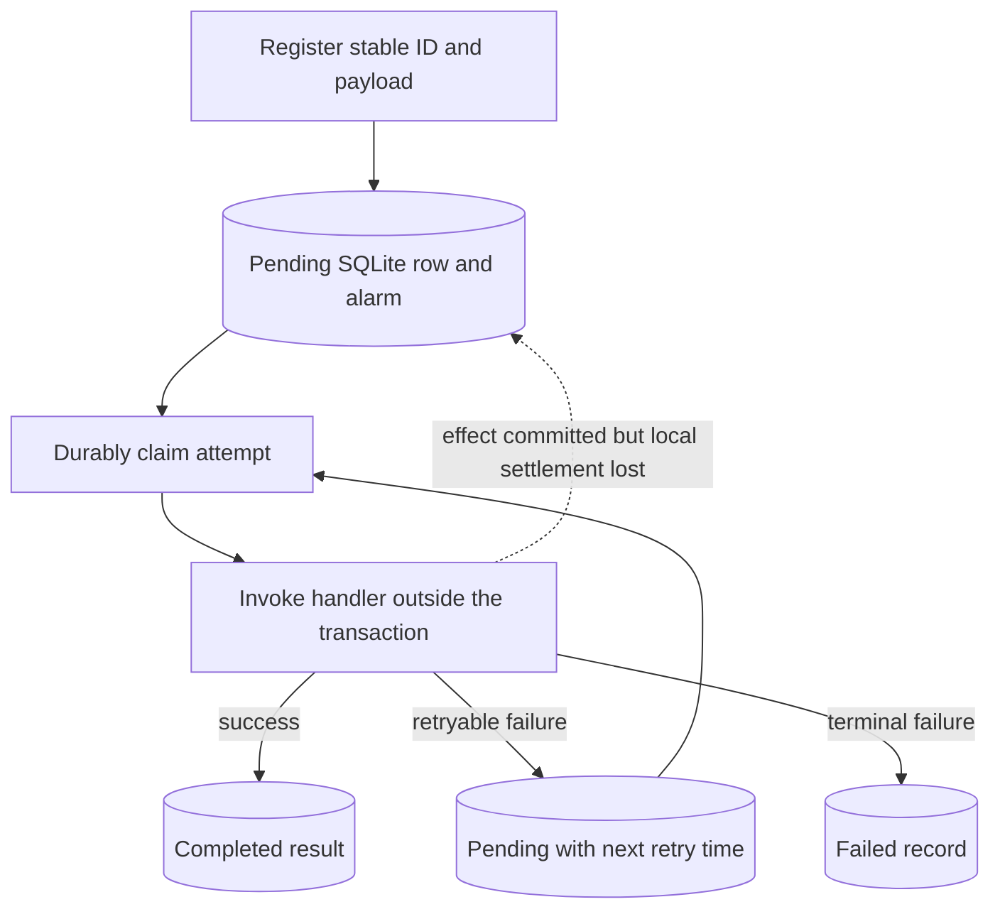

Import `Durability` from `durability`. Use it for individually identified jobs whose results must survive retries and restarts. See [recurring billing](/compositions/recurring-billing/) for composition with named alarms.

## Behind the scenes

**Durable state:** `durability_calls` holds one row per operation ID: handler name, serialized payload, generation, status, attempt count, retry time, error, and result. Shared `durability_memos` holds intermediate memoized results. Pending-time and creation-time indexes support scheduling and purge.

1. Registration serializes the payload and inserts a pending row in a storage transaction. An existing ID must match both handler and canonical payload. The transaction also reconciles the physical alarm.
2. A new operation starts eagerly only if the shared scheduler has an immediately available permit. Otherwise the persisted due row waits for a timer/alarm pass.
3. Before calling the handler, the engine durably claims and increments its attempt. An in-memory active lock prevents overlapping same-instance execution.
4. Successful settlement conditionally stores the JSON result. Failure either records the next retry time or a terminal failed state. Generation/attempt checks prevent a late old execution from overwriting a purged-and-reused ID.



**After eviction:** the row survives, but locks and running promises do not. A pending handler can run again with the same ID. A remote effect may already have committed; receiver-side idempotency is still necessary. Abort is cooperative: a handler that ignores its signal holds the live permit until it actually settles.

**Lifetime:** completed and failed records stay indefinitely until destructive `purgeBefore()`. Purging also removes deduplication protection and memos.

Implementation: [`durability.ts`](https://github.com/avenceslau/durability/blob/main/packages/durability/src/durability.ts) (`DurabilityCore`), [`storage.ts`](https://github.com/avenceslau/durability/blob/main/packages/durability/src/storage.ts) (attempt claims and conditional updates).

## Durable operations

```ts
import { DurableObject } from 'cloudflare:workers';
import { Durability, type DurableCall } from 'durability';

type ResizeInput = { imageId: string };

export class ImageJobs extends DurableObject<Env> {
  private readonly durability = new Durability({
    context: this.ctx,
    handlers: {
      resizeImage: async ({ id, payload }: DurableCall<ResizeInput>) =>
        this.env.IMAGES.resize(payload.imageId, { idempotencyKey: id }),
    },
    retries: { maxAttempts: 3 },
    methods: { resizeImage: { attemptTimeoutMs: 60_000 } },
  });

  resize(imageId: string) {
    return this.durability.resizeImage({
      id: `resize:${imageId}`,
      payload: { imageId },
    });
  }

  result(imageId: string) {
    return this.durability.resizeImage.getResult(`resize:${imageId}`);
  }

  alarm(info?: AlarmInvocationInfo) {
    return this.durability.alarm(info);
  }
}
```

Every handler becomes a method on the instance. Handler names that collide with instance members (`alarm`, `purgeBefore`) are rejected at construction.

### Reading results

```ts
const result = await this.durability.resizeImage.getResult(`resize:${imageId}`);

switch (result.status) {
  case 'not_found':
    break;
  case 'pending':
    console.log(result.attempt, result.nextAttemptAt, result.lastError);
    break;
  case 'failed':
    console.error(result.error.name, result.error.message);
    break;
  case 'completed':
    console.log(result.result);
    break;
}
```

The completed result type is inferred from the handler. Looking up a key that belongs to another operation throws `DuplicateDurableCallError`. Payloads and results must be JSON-serializable; as with `JSON.stringify`, `undefined` properties are dropped and `undefined` array elements become `null`.

An ID stays bound to its operation and payload. Registering it again with the same operation and the same data (object key order does not matter; array order and values do) is a no-op, which is what makes retries safe. Registering it with another operation throws `DuplicateDurableCallError`, and with a different payload `DuplicateDurablePayloadError`, instead of silently dropping the new call.
