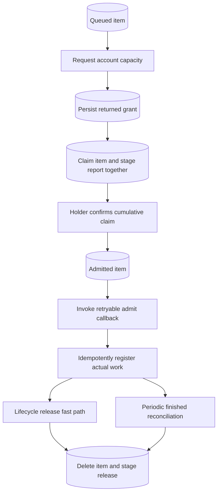

Import `DurabilitySemaphoreQueue` from `durability/experimental/semaphore` and pin an exact version. It is the durable client-side admission queue for a [semaphore holder](/primitives/semaphore/), not another global budget.

## Behind the scenes

**Durable state:** queue item, grant, pacing-key, and optional lease tables hold local demand and allocated capacity. An internal [outbox](/primitives/outbox/) channel, `durability.semaphore-queue`, persists cumulative claim/release reports on the same scheduler.

`enqueue()` idempotently inserts items by ID. Demand is aggregated per semaphore key and group. Returned grants are stored transactionally; local claims and their outbound reports commit together. Grant-based work becomes admitted after holder confirmation. Lease-drawn work can be admitted locally because its capacity was already reserved at the holder.



**After a crash:** `admit()` runs after admission commits and may be called again until it returns. Register actual operations using the same stable item ID so repeat admission is a no-op. Lost report replies are repaired by durable cumulative accounting, not by assuming a failed RPC did nothing.

**Releasing:** a successful lifecycle hook is a fast path, not a guarantee. Supply `finished(ids)` to check authoritative durable outcomes and recover a missed release. Without it, capacity can remain charged indefinitely. Define how `not_found` should be interpreted before purging operation history.

Request-in-flight state and blocked-reason diagnostics are in memory and advisory. The [account concurrency composition](/compositions/account-concurrency/) explains the complete holder/queue/operation design and its external-task limits.

Implementation: [`semaphore-queue.ts`](https://github.com/avenceslau/durability/blob/main/packages/durability/src/semaphore-queue.ts), [`semaphore-queue-store.ts`](https://github.com/avenceslau/durability/blob/main/packages/durability/src/semaphore-queue-store.ts).

## Queueing work in a client Durable Object

`DurabilitySemaphoreQueue` is the client half: it queues items per semaphore key in arrival order, drives the protocol above against the holder, and hands items to the application once a permit is confirmed. Claims and releases are published through an internal `DurabilityOutbox` channel as cumulative counts, so a crash or lost response never loses or double-counts a permit.

```ts
import { DurableObject } from 'cloudflare:workers';
import { timeout } from '@durability/transforms';
import { Durability, DurabilityScheduler } from 'durability';
import { DurabilitySemaphoreQueue } from 'durability/experimental/semaphore';

/** Many shards, each queueing jobs for many accounts. */
export class JobShard extends DurableObject<Env> {
  private readonly scheduler = new DurabilityScheduler({ context: this.ctx });
  private readonly jobs = new Durability({
    scheduler: this.scheduler,
    handlers: { run: (job: Job) => runJob(this.env, job) },
    // Return the permit as soon as the operation reaches a terminal state.
    onLifecycleEvent: (event) => {
      if (
        event.type === 'terminal' ||
        (event.type === 'attempt_settled' && event.outcome === 'completed')
      ) {
        return this.permits.release(event.id).then(() => undefined);
      }
    },
  });
  private readonly permits = new DurabilitySemaphoreQueue<Job>({
    scheduler: this.scheduler,
    clientId: this.ctx.id.toString(),
    server: limits.with(timeout, 5_000),
    admit: (items) =>
      Promise.all(
        items.map((item) => this.jobs.run({ id: item.id, payload: item.body }))
      ),
    // The hook above is best-effort; this check returns any permit it missed.
    finished: async (ids) => {
      const results = await Promise.all(
        ids.map((id) => this.jobs.run.getResult(id))
      );
      return ids.filter((_, index) => results[index]!.status !== 'pending');
    },
  });

  submit(job: Job) {
    return this.permits.enqueue([
      { id: job.id, key: job.accountId, group: job.workflowId, body: job },
    ]);
  }

  override alarm(info?: AlarmInvocationInfo) {
    return this.scheduler.alarm(info);
  }
}
```

- **States.** An item is `queued` until permits arrive, `claiming` while the holder confirms the claim, and `admitted` once `admit()` has been handed the item. Items drawn from a lease skip `claiming` and are admitted at once; `AdmittedItem.via` says which path admitted an item. `admit()` runs after the admission commits and is retried under `retries.delay` until it returns, so it must be idempotent on item ID. `release(id)` returns the permit; `cancel(id)` removes an item that is still `queued`.
- **Releasing.** Call `release(id)` when the work ends, and pass `finished(ids)` so a release that never happens — a lifecycle hook is best-effort, a crash can come between the work ending and the call — does not hold the permit forever. The queue asks `finished` about each admitted item `finishedCheckMs` (default 60 seconds) after `admit()` returned, and again at that interval, releasing the ones it reports done. Without `finished`, a lost `release()` leaks the permit until the item is released by hand.
- **Requests.** Each key is asked at most once per `nextRequestAt`, with demand aggregated per group from the oldest queued items. A failed request, or one unanswered after `attemptTimeoutMs`, is retried with backoff. Items whose key already holds unclaimed permits — a grant sized for demand that was cancelled, say — are admitted without a request.
- **Blocked attribution.** `status(id)` on a queued item carries the holder's most recent reason for that key and group (`limit`, `group_limit`, …); `blocked` lifecycle events report counts per group. Attribution is in-memory and best-effort.
- **Composition.** The queue shares the scheduler with everything else in the object and creates its own outbox channel (`durability.semaphore-queue`) on it; one queue per scheduler. Pass `DurabilitySemaphore.client()` as `server` — caller transforms apply to every request and sync.

`DurabilitySemaphoreQueue.migrate(this.ctx, null)` removes the queue schema. See the typechecked [account concurrency composition](https://github.com/avenceslau/durability/blob/main/examples/account-concurrency).
