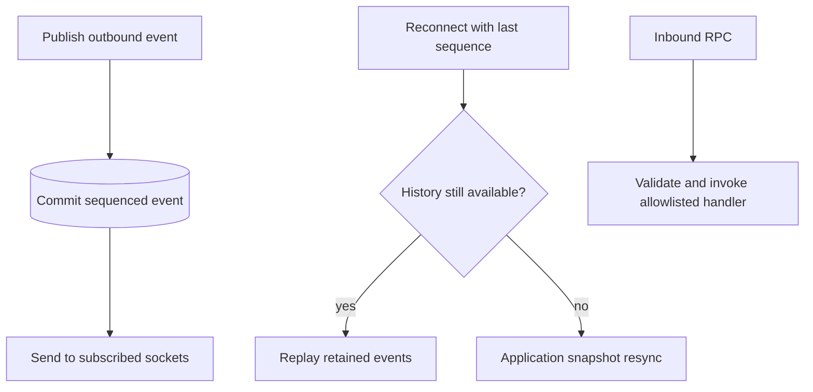

Import `DurabilitySocket` from `durability/socket`. Expose an explicit inbound RPC allowlist and publish replayable outbound events. The [browser client](/primitives/client/) is documented separately.

## Behind the scenes

**Durable state:** `durability_socket_events` stores a sequence, event name, JSON payload, and creation time. Upgrade metadata and subscribed event names are kept in hibernatable WebSocket attachments. Runtime ping auto-responses avoid waking the object for idle keepalives.

An outbound call inserts its event before sending it to current subscribers, then trims history to its retention window. Reconnection subscribes from a sequence: matching retained rows replay in order, while an absent, ahead-of-head, or too-old cursor tells the client to resync from a snapshot.



**Not durable RPC execution:** the socket does not persist or deduplicate inbound calls. A connection can disappear after a mutation committed but before its response arrives. Route retried mutations through an operation with a stable ID rather than assuming socket reconnect makes them safe.

There are no durable per-client event acknowledgements or delivery cursors. Events can repeat on reconnect, and bounded history can require resync. The fronting Worker owns authentication and tenant authorization; stored metadata is context, not an authorization policy.

See [live job dashboards](/compositions/job-dashboard/) for composition with a durable read model.

Implementation: [`socket.ts`](https://github.com/avenceslau/durability/blob/main/packages/durability/src/socket.ts) (`DurabilitySocketCore`, publication/replay) and [`socket-protocol.ts`](https://github.com/avenceslau/durability/blob/main/packages/durability/src/socket-protocol.ts).

## Browser sockets

`DurabilitySocket` lets browsers call a Durable Object and receive events from it over one hibernatable WebSocket. `inbound` handlers become callable methods on the client; `outbound` events become methods on the socket that push to every subscribed connection. Nothing outside `inbound` is reachable, and no result is broadcast unless an outbound method sends it.

```ts
import { DurableObject } from 'cloudflare:workers';
import {
  Durability,
  type DurableCall,
  type DurabilityLifecycleEvent,
} from 'durability';
import { DurabilitySocket, event, type SocketCall } from 'durability/socket';
import { z } from 'zod';

const TodoSchema = z.object({
  id: z.string(),
  title: z.string(),
  done: z.boolean(),
});
type Todo = z.infer<typeof TodoSchema>;
type Metadata = { userId: string };

export class TodoList extends DurableObject<Env> {
  private readonly todos = new Map<string, Todo>();

  readonly durability = new Durability({
    context: this.ctx,
    handlers: {
      createTodo: async ({ payload }: DurableCall<Todo>) => {
        this.todos.set(payload.id, payload);
        return payload;
      },
    },
    // Lifecycle events omit handler results unless this is set.
    includeResults: true,
  });

  readonly socket = new DurabilitySocket({
    context: this.ctx,
    inbound: {
      // Bare handlers take no input (or `unknown` input they validate themselves).
      list: () => [...this.todos.values()],
      // Typed input requires a Standard Schema; here the handler is a durable operation.
      createTodo: {
        input: z.object({ id: z.string(), payload: TodoSchema }),
        handle: this.durability.createTodo,
      },
      toggle: {
        input: z.string(),
        handle: (id: string, call: SocketCall<Metadata>) => {
          const todo = this.todos.get(id);
          if (!todo) {
            throw new RangeError(`No todo "${id}" for ${call.metadata.userId}`);
          }
          todo.done = !todo.done;
          this.socket.updated(todo);
          return todo;
        },
      },
    },
    outbound: {
      created: event<Todo>(),
      updated: event<Todo>(),
      lifecycle: event<DurabilityLifecycleEvent>(),
    },
    metadata: (request): Metadata => ({
      userId: request.headers.get('x-user-id') ?? 'anonymous',
    }),
  });

  constructor(ctx: DurableObjectState, env: Env) {
    super(ctx, env);
    // Push a durable operation's result to every subscriber once it has committed.
    this.durability.lifecycle((e) => {
      if (
        e.type === 'attempt_settled' &&
        e.outcome === 'completed' &&
        e.result !== undefined
      ) {
        this.socket.created(e.result);
      }
    });
    this.durability.lifecycle(this.socket.lifecycle);
  }

  fetch(request: Request) {
    return this.socket.fetch(request);
  }

  webSocketMessage(ws: WebSocket, message: string | ArrayBuffer) {
    return this.socket.webSocketMessage(ws, message);
  }

  webSocketClose(ws: WebSocket) {
    this.socket.webSocketClose(ws);
  }

  alarm(info?: AlarmInvocationInfo) {
    return this.durability.alarm(info);
  }
}

// The Worker authenticates, then forwards the upgrade with trusted metadata.
export default {
  async fetch(request: Request, env: Env) {
    const listId = new URL(request.url).pathname.split('/').pop() ?? '';
    const userId = await authenticate(request);
    if (!userId) {
      return new Response('Unauthorized', { status: 401 });
    }
    const upgrade = new Request(request, {
      headers: { ...Object.fromEntries(request.headers), 'x-user-id': userId },
    });
    return env.TODO_LISTS.getByName(listId).fetch(upgrade);
  },
};
```

An inbound handler is either a bare function, which receives no input or `unknown` input it validates itself, or `{ input, handle }`, where `input` is any [Standard Schema](https://standardschema.dev) validator (zod, Valibot, ArkType, …) and `handle` declares its parameter type. A bare function that claims a typed parameter does not compile. Handlers receive `call.metadata`, the value `metadata(request)` returned at upgrade time; it is stored in the WebSocket attachment, so it survives hibernation. The fronting Worker is responsible for authentication and for routing the upgrade to the right object; the socket does no authorization of its own. `metadata` must be assignable to every `SocketCall<…>` annotation the handlers declare.

Every outbound event is persisted to `durability_socket_events` with a sequence number before it is pushed. A reconnecting client subscribes from the last sequence it saw: events still within `retention` (default 1000) are replayed in order, otherwise the client is told to resync and should rebuild its state from an inbound snapshot call. Payloads must be JSON. Keep-alive pings are answered by the runtime through `setWebSocketAutoResponse`, so idle connections never wake the object. Frames over 1 MiB are rejected; malformed frames close the connection with code `4002`.

Connect using [DurabilitySocketClient](/primitives/client/).
