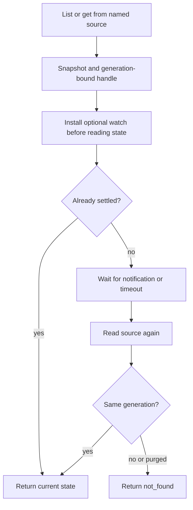

Import `DurabilityTracker` from `durability/experimental` and pin an exact version. Use one query/wait interface over capabilities or your own `TrackedSource` implementations.

## Behind the scenes

**Durable state: none of its own.** The tracker delegates reads to its named sources. Each source owns its records, transactions, status semantics, and retention. Pagination visits sources in configured order; there is no globally ordered merged timeline.

A handle contains a record snapshot, its generation, and `get()`/`wait()` methods. Later reads compare generations so an old handle cannot accidentally observe a new record reusing the same ID.



**Waiting is in memory:** installing the watch before the initial read avoids a settlement-between-read-and-subscribe race, but watches and timers do not survive eviction, redeploy, or RPC disconnect. Reacquire a handle by ID and wait again. A custom source without `watch` is read at timeout; the tracker does not poll it continuously.

**Transport:** Workers RPC can carry callable handles; JSON sockets cannot. Use `records()` for snapshots over sockets. A dashboard projection and authoritative pipeline can each expose a tracker, but querying the former does not automatically reconcile it with the latter.

See [live job dashboards](/compositions/job-dashboard/) for both transports and their failure boundaries.

Implementation: [`tracker.ts`](https://github.com/avenceslau/durability/blob/main/packages/durability/src/tracker.ts) (collection and waiting) and [`tracked-source.ts`](https://github.com/avenceslau/durability/blob/main/packages/durability/src/tracked-source.ts).

## Tracking work (experimental)

Everything under `durability/experimental` may change or be removed in a minor release and is excluded from the semver guarantee of the root package. Pin an exact version when depending on it. Nothing from this entry point is reachable from `durability`, and it adds nothing to the public types of `Durability` or `DurabilityAlarms`.

`DurabilityTracker` lists records from several sources. Sources are keyed by names you choose; the key becomes each record's `source`.

```ts
import { DurabilityTracker } from 'durability/experimental';

export class ImageJobs extends DurableObject<Env> {
  // scheduler, durability, and alarms as above

  private readonly tracker = new DurabilityTracker({
    sources: { jobs: this.durability, alarms: this.alarms },
  });

  listWork(cursor?: string) {
    return this.tracker.list({ status: 'pending', limit: 50, cursor });
  }

  getWork(id: string) {
    return this.tracker.get('jobs', id);
  }
}
```

All three methods take the same query: `{ source, name, status, limit, cursor }`. `limit` defaults to 50 and is capped at 100. Pass `cursor` back with the same query to continue; it is present only while more records may follow. Sources are read one after another, so there is no ordering across sources.

- `list(query)` returns `{ items, cursor }`. Each item has `source`, `id`, `name`, `generation`, `createdAt`, and `state`, plus `get()`, which reads the latest state, and `wait({ timeoutMs })`, which resolves once the record is `completed` or `failed`, or returns the latest state after the timeout without polling storage. Both return `not_found` once the record is purged or its ID is reused for new work.
- `get(source, id)` returns one such handle, or `undefined`.
- `records(query)` returns `{ records, cursor }` with the same data and no functions.

Narrowing on `source` and `name` narrows `state.result` to that handler's result type. A pending operation or alarm also lists `state.memoized`, the keys its next attempt will [reuse](/reference/memoization/#memoize).

### Handles over RPC

Return handles from a Durable Object method. Over Workers RPC or [Cap'n Web](https://github.com/cloudflare/capnweb), the data fields are copied and `get` and `wait` become stubs, so a caller can wait without polling:

```ts
const { items } = await env.IMAGE_JOBS.getByName('jobs').listWork();
for (const item of items) {
  const result = await item.wait({ timeoutMs: 30_000 });
}
```

Workers RPC pipelining also lets a caller wait in the same round trip that returns the handle, for example `stub.getWork(id).wait({ timeoutMs })` when the method always returns a handle. Waiting is in memory: if a deployment, eviction, or disconnect interrupts it, get a new handle by ID and wait again. Stubs follow the RPC system's disposal rules; dispose them with `using` or let the request end.

### Records over sockets

`DurabilitySocket` frames are JSON, so functions do not survive the trip. Expose `records` as an inbound snapshot and push changes as outbound events, for example from a lifecycle hook:

```ts
readonly socket = new DurabilitySocket({
  context: this.ctx,
  inbound: {
    work: {
      input: z.object({ cursor: z.string().optional() }),
      handle: (query: { cursor?: string }) => this.tracker.records(query),
    },
  },
  outbound: { settled: event<DurabilityOperationEvent<typeof handlers>>() },
});
```

A complete two-object version, with push through `DurabilityFanout` and request/response through a pipelined `wait`, lives in [`examples/job-dashboard`](https://github.com/avenceslau/durability/blob/main/examples/job-dashboard).

### Sources

`Durability` lists every operation. `DurabilityAlarms` lists pending and failed occurrences only, because success deletes an occurrence; a waiter still sees `completed`. Rescheduling an alarm replaces its occurrence, so waiters on the old one receive `not_found`.

Any object implementing `TrackedSource` can be a source, for example work kept in the application's own table:

```ts
import type { TrackedSource } from 'durability/experimental';

type Approvals = { approval: { approvedBy: string } };

const approvals: TrackedSource<Approvals> = {
  get: async (id) => readApproval(id),
  list: async ({ limit, cursor, status, name }) =>
    listApprovals(limit, cursor, status, name),
  watch: (id, listener) => subscribeToApproval(id, listener),
};

new DurabilityTracker({ sources: { jobs: this.durability, approvals } });
```

- `get(id)` and `list(query)` return records with `id`, `name`, `generation`, `createdAt`, and `state`. Keep `generation` stable unless the ID is reused for new work.
- `state.status` is `pending`, `completed`, or `failed`. Express finer outcomes, such as a rejection, as `failed` with a specific `error.name`.
- `list` may return fewer than `limit` records together with a cursor. Omit the cursor at the end.
- `watch(id, listener)` is optional and returns an unsubscribe function. Call `listener()` after a record may have settled; pass the settled record when it can no longer be read. Without `watch`, `wait` reads again only at its timeout.

New members of `TrackedSource` are always optional, so a custom source keeps compiling across releases.
